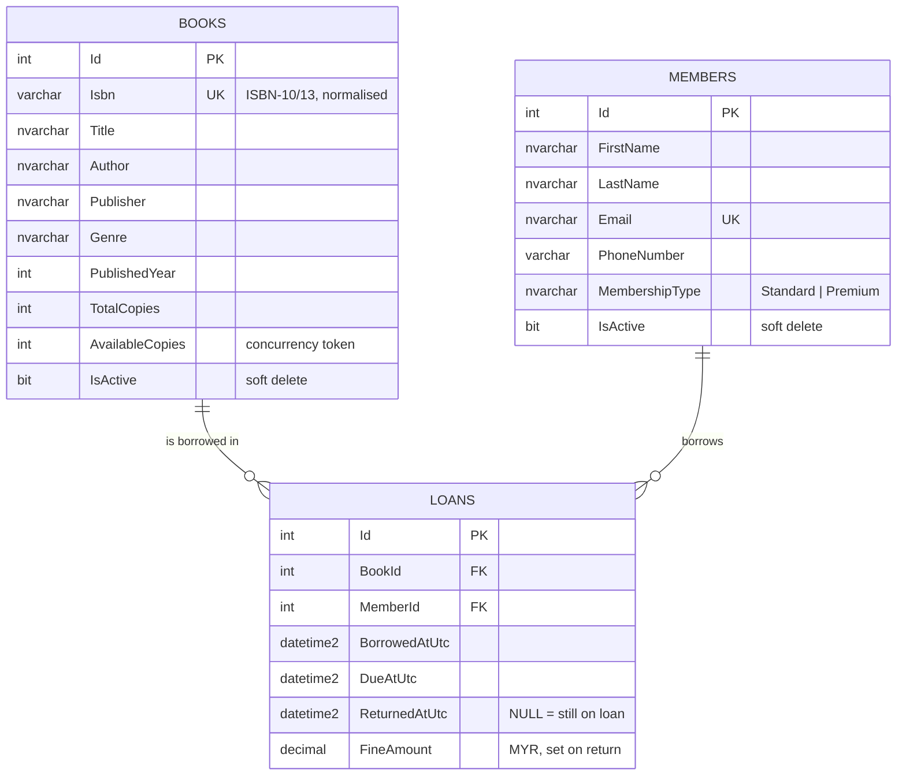

# Library Management System API

A RESTful Web API for a basic library: manage **books** and **members**, and **borrow / return** books with real lending rules (availability, loan limits, due dates, overdue blocking and late fines).

**Stack:** .NET 8 · ASP.NET Core Web API · C# 12 · Entity Framework Core 8 · SQL Server · xUnit · Swagger/OpenAPI

---

## 1. Quick start

**Prerequisites:** .NET 8 SDK and SQL Server LocalDB (installed with Visual Studio 2022, "ASP.NET and web development" workload).

```bash
git clone <repo-url>
cd UobLibraryManagement
dotnet run --project src/LibraryManagement.Api
```

Open **http://localhost:5080/swagger**. On first run the API creates the `UobLibraryDb` database and adds sample books and members.

**No SQL Server?** Use SQLite instead, without changing any code:

```bash
dotnet run --project src/LibraryManagement.Api --Database:Provider=Sqlite
```

**Run the tests** (no database setup needed, because tests use SQLite):

```bash
dotnet test
```

Sample requests are in [`src/LibraryManagement.Api/LibraryManagement.Api.http`](src/LibraryManagement.Api/LibraryManagement.Api.http). They run directly from Visual Studio or VS Code.

---

## 2. Architecture

The solution has four layers. Dependencies point inwards, so the business rules don't depend on the web framework or the database.

```
LibraryManagement.Api            HTTP: controllers, validation, error → ProblemDetails, Swagger
        │
LibraryManagement.Application    Use cases: BookService, MemberService, LoanService, DTOs
        │
LibraryManagement.Domain         Entities + business rules (no EF, no ASP.NET dependency)
        ▲
LibraryManagement.Infrastructure EF Core DbContext, table mappings, SQL Server / SQLite
```

| Layer | Responsibility | Key types |
|---|---|---|
| **Domain** | Entities and rules. Pure C#, unit-testable without a database. | `Book`, `Member`, `Loan`, `Library`, `BorrowingPolicy` |
| **Application** | Orchestrates a use case: load → ask the domain → save. Defines DTOs. | `ILoanService`, `LoanService`, `BorrowBookRequest`, `LoanResponse` |
| **Infrastructure** | Persistence details: table mapping, indexes, constraints, provider choice. | `LibraryDbContext`, `*Configuration`, `DatabaseInitializer` |
| **Api** | Thin controllers, model validation, consistent error responses. | `BooksController`, `LoansController`, `GlobalExceptionHandler` |

**Request flow for "borrow a book":**
`POST /api/loans` → `LoansController` → `LoanService.BorrowBookAsync` loads the book, the member and the member's open loans → `Library.CheckOut(...)` applies every rule and creates the `Loan` → one `SaveChanges` writes the new loan and the stock change in a **single transaction**.

---

## 3. Domain model and database design



All tables also have `CreatedAtUtc` / `UpdatedAtUtc`, set centrally in `LibraryDbContext`. The full DDL is in [`database/schema.sql`](database/schema.sql).

**Data integrity is enforced in the database as well as in code:**

- Unique `Books.Isbn` and `Members.Email`
- `CHECK (AvailableCopies BETWEEN 0 AND TotalCopies)`, `CHECK (DueAtUtc > BorrowedAtUtc)`, `CHECK (FineAmount >= 0)`
- **Filtered unique index** `UX_Loans_Member_Book_Open (MemberId, BookId) WHERE ReturnedAtUtc IS NULL`: a member cannot hold two open loans of the same book
- Foreign keys use `ON DELETE NO ACTION`: loan history can never be lost through a cascade
- Indexes support the common queries (open loans per member, overdue loans)

---

## 4. Business rules

| Rule | Where | Error code (HTTP) |
|---|---|---|
| Book must be in the catalogue and have a copy on the shelf | `Book.CheckOutCopy` | `BOOK_INACTIVE` / `BOOK_UNAVAILABLE` (409) |
| Member must be active | `Library.CheckOut` | `MEMBER_INACTIVE` (409) |
| No new loans while the member has an overdue book | `Library.CheckOut` | `MEMBER_HAS_OVERDUE_LOANS` (409) |
| Loan limit per tier (Standard 3, Premium 10) | `BorrowingPolicy` | `LOAN_LIMIT_REACHED` (409) |
| Only one copy of the same title per member at a time | `Library.CheckOut` + DB index | `BOOK_ALREADY_BORROWED_BY_MEMBER` (409) |
| Due date = borrow date + tier period (Standard 14 days, Premium 30 days) | `BorrowingPolicy.CalculateDueDate` | — |
| Late fine: Standard RM1.00/day; Premium RM0.50/day after 1 grace day; capped at RM50 | `BorrowingPolicy.CalculateFine` | — |
| A loan can only be returned once | `Loan.MarkReturned` | `LOAN_ALREADY_RETURNED` (409) |
| Stock can't go below the copies on loan; a book can't be retired while copies are out | `Book` | `COPIES_BELOW_ON_LOAN` / `BOOK_HAS_ACTIVE_LOANS` (409) |
| A member can't be deactivated while holding books | `Member.Deactivate` | `MEMBER_HAS_ACTIVE_LOANS` (409) |
| Two people can't borrow the last copy at the same moment | `AvailableCopies` concurrency token | `CONCURRENCY_CONFLICT` (409) |
| Unique ISBN / email | services + unique indexes | `DUPLICATE_ISBN` / `DUPLICATE_EMAIL` (409) |

"Overdue" is **calculated** from `DueAtUtc` and the current time, not stored, so it never goes stale and no background job is needed.

---

## 5. API endpoints

| Method | Route | Purpose |
|---|---|---|
| GET | `/api/books?search=&genre=&availableOnly=&includeInactive=&page=&pageSize=` | Search the catalogue (paged) |
| GET | `/api/books/{id}` | Book details and availability |
| POST | `/api/books` | Add a book |
| PUT | `/api/books/{id}` | Update details and number of copies (ISBN can't be changed) |
| DELETE | `/api/books/{id}` | Retire a book (soft delete) |
| GET | `/api/members?search=&membershipType=&includeInactive=&page=&pageSize=` | List members (paged) |
| GET | `/api/members/{id}` | Member details and borrowing limits |
| POST | `/api/members` | Register a member |
| PUT | `/api/members/{id}` | Update a member or change their tier |
| DELETE | `/api/members/{id}` | Deactivate a member (soft delete) |
| POST | `/api/members/{id}/reactivate` | Reactivate a member |
| GET | `/api/members/{id}/loans?status=` | A member's borrowing history |
| GET | `/api/loans?memberId=&bookId=&status=Active\|Overdue\|Returned` | Search loans (paged) |
| GET | `/api/loans/{id}` | Loan details, including days overdue |
| POST | `/api/loans` | **Borrow** a book `{ "bookId": 1, "memberId": 1 }` |
| POST | `/api/loans/{id}/return` | **Return** a book (the fine is calculated) |
| GET | `/health` | Health check |

Borrow and return are modelled as a **Loan resource** (`POST /loans` creates one; `POST /loans/{id}/return` closes it). This keeps a full borrowing history and keeps URLs noun-based.

**Errors** use RFC 7807 `ProblemDetails`, with a stable `code` that clients can use:

```json
{
  "status": 409,
  "title": "Business rule violation",
  "detail": "No copies of 'Clean Code' are currently available.",
  "instance": "/api/loans",
  "code": "BOOK_UNAVAILABLE",
  "traceId": "0HN..."
}
```

| Status | Meaning |
|---|---|
| 400 | Invalid input (data annotations, or domain validation such as a malformed ISBN) |
| 404 | Resource not found |
| 409 | Business rule violation or concurrency conflict |
| 500 | Unexpected error (logged; internal details are not returned to the client) |

---

## 6. Object-oriented design

| Principle | How it's applied |
|---|---|
| **Encapsulation** | Every entity property has a `private set`. State changes only through methods that enforce invariants (`Book.ChangeTotalCopies`, `Member.Deactivate`). Stock changes (`CheckOutCopy` / `ReturnCopy`) and loan creation are `internal`, so **only** the `Library` domain service can perform them. |
| **Abstraction** | Services are consumed through interfaces (`IBookService`, `ILoanService`); persistence is behind `ILibraryDbContext`; time is behind .NET 8 `TimeProvider`. |
| **Inheritance** | `Entity` is the base class providing `Id` and audit fields to `Book`, `Member` and `Loan`. `BorrowingPolicy` is an abstract base for the membership tiers. |
| **Polymorphism** | `StandardBorrowingPolicy` and `PremiumBorrowingPolicy` override limits, loan period and `CalculateFine` (Premium adds a grace period). `Library` calls `member.Policy.CalculateFine(...)` without knowing which tier it has. |
| **Single Responsibility** | Controllers handle HTTP; services orchestrate; the domain decides; the DbContext persists. |
| **Open/Closed** | A new tier (e.g. Student) is a new `BorrowingPolicy` subclass; the lending logic doesn't change. |
| **Dependency Inversion** | Application depends on `ILibraryDbContext`, not on SQL Server; Infrastructure implements it. |

---

## 7. Design decisions and trade-offs

- **Copy counts instead of a `BookCopy` table.** The assessment asks for a basic system, so `TotalCopies` / `AvailableCopies` is enough. If the library needs to track individual barcodes or the condition of each copy, `BookCopy` becomes its own entity and `Loan` references the copy. The `Library` service is the only place that would change.
- **No repository layer over EF Core.** `DbContext` already implements the Unit of Work and Repository patterns. Wrapping it again adds code without adding value. Services depend on the `ILibraryDbContext` abstraction, which keeps them testable.
- **Soft delete** for books and members, so loan history (an audit trail) is always kept.
- **Optimistic concurrency** on `AvailableCopies` instead of locks. This prevents overselling the last copy and keeps throughput high.
- **`TimeProvider` injection** makes due dates and fines deterministic in tests.
- **`EnsureCreated` for schema creation** keeps reviewer setup to one command. For production I would use EF Core migrations (`dotnet ef migrations add InitialCreate`) applied by the deployment pipeline.
- **Money** is stored as `DECIMAL(10,2)`, never as a floating-point type.

---

## 8. Testing

```
tests/LibraryManagement.Tests
├── Domain/        Unit tests: Book invariants, BorrowingPolicy fines, Library lending rules
├── Application/   LoanService against a real relational DB (SQLite in-memory),
│                  including a concurrency test for the "last copy" race
└── Api/           End-to-end HTTP tests via WebApplicationFactory: status codes, error codes, full borrow/return flow
```

The tests use **SQLite in-memory rather than the EF InMemory provider**, so unique indexes, check constraints and concurrency tokens are actually exercised.

---

## 9. What I'd add next in production

Authentication and role-based authorisation (librarian vs member) · EF Core migrations · reservations/hold queue when a book is unavailable · fine payment tracking · structured logging and correlation IDs (Serilog + OpenTelemetry) · rate limiting · API versioning · Docker image and CI pipeline (build, test, publish).
